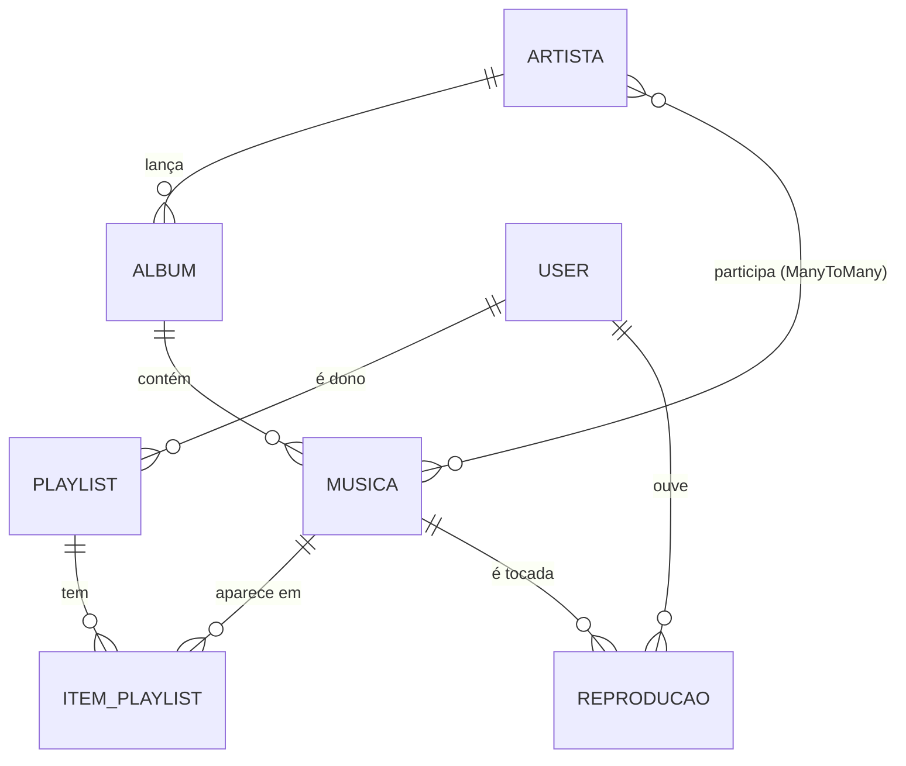

# 🎵 SomTeca

**SomTeca** é uma biblioteca de músicas e playlists feita em **Django**, com visual escuro inspirado no Spotify. Tem player de MP3 fixo no rodapé, ranking das mais ouvidas e uma retrospectiva anual no estilo "Wrapped".

> Projeto acadêmico desenvolvido no **IFRS**.

---

## ✨ Funcionalidades

| Recurso | O que faz |
|---|---|
| **CRUD completo** | Cadastrar, listar (cards, 12 por página), ver detalhes, editar e excluir (com confirmação) **artistas, álbuns, músicas e playlists**, usando Class-Based Views e ModelForms |
| **Player de MP3** | Player fixo no rodapé com play/pause, anterior, próxima, barra de progresso e volume (`<audio>` do HTML5 + JavaScript puro). Cada play é registrado no banco via `fetch` (POST com token CSRF) |
| **Ranking** | Top 10 de músicas, artistas e álbuns, com filtro por período (última semana, último mês, sempre) e gráfico de barras (Chart.js) |
| **Retrospectiva** | Resumo do ano do usuário logado: minutos ouvidos, top 5 músicas e artistas, gênero favorito e mês em que mais ouviu (gráfico de linha), tudo em cards coloridos |
| **Autenticação** | Cadastro, login e logout (`django.contrib.auth`). Só usuários logados criam playlists e veem a retrospectiva, e cada usuário só edita ou exclui as próprias playlists |
| **Busca** | Barra no topo que procura em músicas, artistas e álbuns ao mesmo tempo (objetos `Q`) |
| **Filtros** | Músicas por gênero, álbuns por ano |
| **Dashboard** | Contadores gerais, músicas adicionadas recentemente e as mais tocadas da semana |
| **Mensagens** | Avisos de sucesso/erro com `django.contrib.messages` |
| **Admin** | Django Admin com `list_display`, `search_fields` e `list_filter` em todos os models, além de inlines |

## 🛠️ Tecnologias

- Python 3.12+ e Django 6
- SQLite
- Bootstrap 5 e Bootstrap Icons (via CDN)
- Chart.js 4 (via CDN)
- Pillow (upload de imagens)
- Templates Django (sem React e sem API REST)

---

## 🚀 Como rodar

### 1. Clonar o projeto
```bash
git clone https://github.com/joaobleyb/somteca-victor.git
cd somteca-victor
```

### 2. Criar e ativar o ambiente virtual
```bash
python -m venv venv

# Windows (PowerShell)
venv\Scripts\Activate.ps1
# Windows (cmd)
venv\Scripts\activate.bat
# Linux / macOS
source venv/bin/activate
```

### 3. Instalar as dependências
```bash
pip install -r requirements.txt
```

### 4. Criar as tabelas do banco (migrations)
```bash
python manage.py migrate
```

### 5. Criar o superusuário (para acessar o /admin)
```bash
python manage.py createsuperuser
```

### 6. (Opcional, recomendado) Popular o banco com músicas reais e dados de exemplo
```bash
python manage.py popular_banco
```
O comando precisa de internet e baixa cerca de 210 MB. Ele cria:
- **30 músicas reais de Kevin MacLeod** (licença livre CC BY 4.0, veja os [créditos](#-créditos-das-músicas)) em 6 coletâneas com capas geradas automaticamente: *Lounge & Jazz*, *Diversão Garantida*, *Pixels & Sintetizadores*, *Groove*, *Adrenalina* e *Clássicos Revisitados*;
- 4 usuários: `demo`, `ana`, `bruno` e `carla`, todos com a senha **`somteca123`**;
- playlists públicas e privadas, incluindo "Músicas Reais (CC BY)" com as 30 faixas;
- 4.000 reproduções espalhadas pelos últimos 14 meses, para o ranking e a retrospectiva terem conteúdo.

Opções: `--limpar` apaga o catálogo antes de popular, e `--reproducoes 10000` muda a quantidade de reproduções.

Os MP3 ficam em `media/` e não vão para o Git. Rodar o comando de novo não baixa tudo outra vez. A duração de cada faixa é calculada lendo o cabeçalho do próprio MP3 (função `duracao_mp3`, sem biblioteca extra).

> Só quer as músicas, sem usuários nem playlists de teste? Use `python manage.py importar_musicas_reais`.

### 7. Iniciar o servidor
```bash
python manage.py runserver
```
Acesse **http://127.0.0.1:8000** (site) e **http://127.0.0.1:8000/admin** (administração).

---

## 📁 Estrutura do projeto

```
somteca/                      ← configurações do projeto (settings, urls, wsgi)
musica/                       ← app do catálogo
├── models/                   ← um arquivo por model
│   ├── artista.py
│   ├── album.py              (inclui a lista de GENEROS)
│   ├── musica.py
│   └── reproducao.py
├── views/                    ← views separadas por assunto
│   ├── artista_views.py      (CRUD)
│   ├── album_views.py        (CRUD + filtro por ano)
│   ├── musica_views.py       (CRUD + filtro por gênero)
│   ├── dashboard_views.py
│   ├── ranking_views.py
│   ├── busca_views.py
│   ├── player_views.py       (registra cada reprodução)
│   └── mixins.py             (código comum de formulário/exclusão)
├── templatetags/somteca_tags.py   ← tag  que envia a fila ao player
├── management/commands/popular_banco.py
├── forms.py, admin.py, urls.py, utils.py
playlists/                    ← app das playlists
├── models/ (playlist.py, item_playlist.py)
├── views/  (playlist_views.py, item_views.py, mixins.py)
├── forms.py, admin.py, urls.py
usuarios/                     ← app de autenticação + retrospectiva
├── views/  (auth_views.py, retrospectiva_views.py)
├── forms.py, urls.py
templates/                    ← templates com herança, em pastas
├── base.html                 (navbar + mensagens + rodapé + player)
├── partials/                 (navbar, player, cards, lista de faixas, paginação...)
├── compartilhado/            (form.html e confirmar_exclusao.html usados por todo o CRUD)
├── musica/ (artista/, album/, musica/, dashboard, ranking, busca)
├── playlists/
└── usuarios/ (login, cadastro, retrospectiva)
static/
├── css/style.css             ← tema escuro
└── js/player.js              ← player de MP3
```

## 🗃️ Modelo de dados



- **Artista**: nome, biografia, foto, país de origem, data de criação
- **Album**: título, artista (FK), ano de lançamento, capa, gênero
- **Musica**: título, álbum (FK), artistas (M2M, para participações), arquivo .mp3, duração (segundos), nº da faixa, contador de reproduções
- **Playlist**: nome, descrição, capa, dono (FK User), músicas (M2M **através de `ItemPlaylist`**), pública/privada
- **ItemPlaylist**: playlist, música, **ordem** e **data em que foi adicionada**
- **Reproducao**: usuário (opcional, visitantes também contam), música, data/hora

## 🔎 Detalhes que valem explicar na apresentação

- **Como o player sabe o que tocar?** Cada página gera um `<script type="application/json">` com a lista de faixas (tag ``). Os botões de play têm `data-fila` e `data-indice`, e o `player.js` lê esse JSON e monta a fila.
- **Como cada play é registrado?** Quando a faixa começa, o `player.js` faz `fetch(POST)` para `/player/reproducao/<id>/` mandando o cookie `csrftoken` no cabeçalho `X-CSRFToken`. A view cria um `Reproducao` e incrementa o contador com `F()`, o que evita condição de corrida.
- **Ranking e retrospectiva** usam `annotate(Count(...))` com `filter=Q(...)`, `Sum` e `ExtractMonth`, então toda a agregação é feita pelo banco de dados.
- **Permissões das playlists:** `LoginRequiredMixin` + `UserPassesTestMixin` (`DonoPlaylistMixin`). Playlists privadas de outros usuários retornam 404.
- **Duração em mm:ss:** o formulário aceita "3:45" e converte para 225 segundos em `clean_duracao`.

## 🎼 Créditos das músicas

As 30 faixas baixadas por `popular_banco` / `importar_musicas_reais` são de **Kevin MacLeod ([incompetech.com](https://incompetech.com))**, licenciadas sob **Creative Commons: By Attribution 4.0**
([creativecommons.org/licenses/by/4.0](https://creativecommons.org/licenses/by/4.0/)).

Faixas: Airport Lounge, Backbay Lounge, Bossa Antigua, Night on the Docks (Sax), Smooth Lovin, Monkeys Spinning Monkeys, Fluffing a Duck, Sneaky Snitch, Scheming Weasel (faster), Pixel Peeker Polka (faster), Spazzmatica Polka, Life of Riley, Itty Bitty 8 Bit, Hyperfun, Blip Stream, Chill Wave, Aitech, Ouroboros, Funkorama, Groove Grove, Cool Vibes, Rollin at 5, Easy Lemon, Killers, Volatile Reaction, Cut and Run, Furious Freak, Hitman, Gymnopedie No 1, Danse Macabre.

As coletâneas (nomes e capas) foram montadas para este projeto e não são álbuns oficiais do artista.

## ⚠️ Limitações conhecidas

- A navegação recarrega a página, então a música para ao trocar de página. Manter o player tocando exigiria transformar o site em SPA, o que foge do escopo (sem React/API).
- Configurações pensadas para desenvolvimento (`DEBUG=True`, `SECRET_KEY` fixa). Para produção, use variáveis de ambiente.

## 👤 Autor

[joaobleyb](https://github.com/joaobleyb) · IFRS
